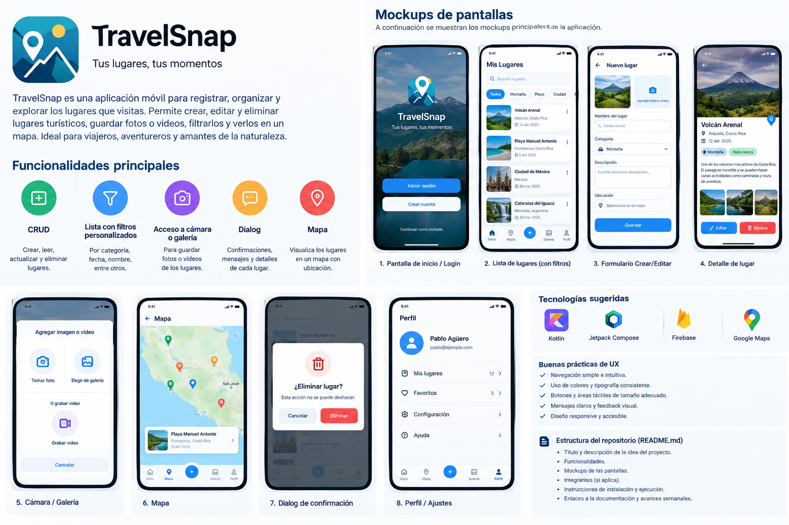

# TravelSnap — Tus lugares, tus momentos

## Descripción del proyecto

TravelSnap es una aplicación móvil diseñada para registrar, organizar y explorar lugares turísticos y naturales. Permite a los usuarios guardar información de sus destinos favoritos, adjuntar fotografías, aplicar filtros personalizados y visualizar las ubicaciones en un mapa.

La aplicación busca facilitar la planificación de visitas a lugares como playas, montañas, volcanes, cascadas y parques naturales.

**Tipo de proyecto:** Aplicación móvil Android.

**Modalidad:** Individual.

## Objetivo general

Desarrollar una aplicación móvil que permita gestionar lugares turísticos mediante operaciones CRUD, filtros personalizados, acceso a imágenes del dispositivo y visualización de ubicaciones geográficas.

## Funcionalidades principales

### 1. Gestión de lugares (CRUD)
- Crear nuevos lugares turísticos.
- Consultar la información de cada lugar.
- Actualizar los datos registrados.
- Buscar un lugar por ID desde el formulario y cargarlo en modo edición.
- Confirmar los cambios antes de actualizar o eliminar un lugar.

### 2. Lista y filtros personalizados
- Buscar lugares por nombre.
- Filtrar por categoría y ubicación.
- Filtrar por provincia.
- Mostrar lugares favoritos.
- Ordenar los resultados por nombre.

### 3. Cámara y galería
- Seleccionar imágenes desde la galería.
- Capturar fotografías cuando el dispositivo y los permisos lo permitan.
- Asociar imágenes con cada lugar turístico.

### 4. Diálogos
- Confirmar la eliminación de un lugar.
- Mostrar mensajes de éxito o error.
- Validar formularios y campos obligatorios.

### 5. Vista de ubicaciones
- Seleccionar marcadores en la vista local de ubicaciones.
- Consultar las coordenadas y abrir el detalle del lugar seleccionado.

## Mockups de la aplicación

Los mockups representan una propuesta inicial de diseño de las pantallas de TravelSnap. Se utilizarán como referencia durante el desarrollo.



### Pantallas propuestas
1. Inicio de sesión o pantalla de bienvenida.
2. Listado de lugares con buscador y filtros.
3. Formulario para crear o editar un lugar.
4. Detalle de un lugar turístico.
5. Selección de fotografías desde cámara o galería.
6. Mapa con marcadores.
7. Diálogo de confirmación para eliminar.
8. Perfil y configuración.

## Código utilizado en la entrega

- Kotlin, pantallas XML, `findViewById` e `Intent` para la navegación, como en los ejemplos del curso.
- Modelos, interfaces de repositorio y ViewModels de la Tarea 2. Los lugares se guardan en una lista en memoria, como en el ejemplo de Semana 7.
- `RecyclerView.Adapter`, búsqueda por identificador y `AlertDialog` para las confirmaciones de la Tarea 5.
- Recursos en español e inglés. Las pantallas de la Tarea 4 conservan los controles para filtrar lugares, adjuntar imágenes y configurar el perfil.

## Estructura inicial del proyecto

```text
TravelSnap/
├── app/
├── docs/
│   └── mockups.png
├── README.md
└── .gitignore
```

La estructura definitiva podrá cambiar conforme avance el desarrollo.

## Plan de trabajo semanal

- **Semana 1:** Crear el repositorio, documentar la idea y definir los mockups.
- **Semana 2:** Crear las pantallas principales y la navegación.
- **Semana 3:** Implementar el CRUD y el almacenamiento local.
- **Semana 4:** Implementar búsqueda y filtros personalizados.
- **Semana 5:** Integrar cámara o galería y diálogos.
- **Semana 6:** Integrar el mapa, realizar pruebas y mejorar la experiencia de usuario.


## Flujo de trabajo con GitHub

El proyecto es individual. Los cambios se publican en `Dev` y se revisan mediante un Pull Request hacia `main`. La integración queda pendiente de la aprobación de `ebarahonautn`.

## Estado del proyecto

Para probar el CRUD, inicia sesión con la cuenta de demostración que muestra la app. Pulsa **+** en **Mis lugares**. Desde el formulario puedes registrar un lugar o escribir el ID de uno existente y pulsar la lupa. El ID de cada lugar aparece en su pantalla de detalle.

Los cambios en los lugares duran mientras se ejecuta la aplicación. La vista de ubicaciones muestra marcadores y coordenadas de los lugares guardados. La integración de un proveedor de mapas queda para una entrega posterior.
