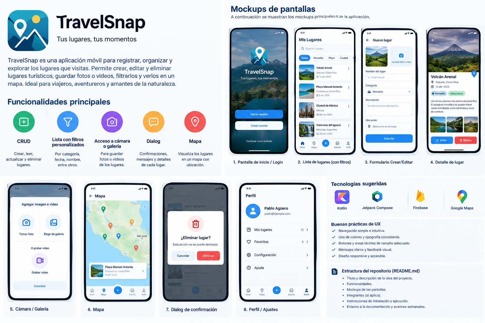

# TravelSnap — Tus lugares, tus momentos

## Descripción del proyecto

TravelSnap es una aplicación móvil diseñada para registrar, organizar y explorar lugares turísticos y naturales. Permite a los usuarios guardar información de sus destinos favoritos, adjuntar fotografías, aplicar filtros personalizados y visualizar las ubicaciones en un mapa.

La aplicación busca facilitar la planificación de visitas a lugares como playas, montañas, volcanes, cascadas y parques naturales.

**Tipo de proyecto:** Aplicación móvil Android.

**Modalidad:** Individual.

## Objetivo general

Desarrollar una aplicación móvil que permita gestionar lugares turísticos mediante operaciones CRUD, filtros personalizados, acceso a imágenes del dispositivo y visualización de ubicaciones geográficas.

## Funcionalidades principales

### 1. Gestión de lugares (CRUD)
- Crear nuevos lugares turísticos.
- Consultar la información de cada lugar.
- Actualizar los datos registrados.
- Eliminar lugares mediante un diálogo de confirmación.

### 2. Lista y filtros personalizados
- Buscar lugares por nombre.
- Filtrar por categoría y ubicación.
- Filtrar por provincia.
- Mostrar lugares favoritos.
- Ordenar los resultados por nombre.

### 3. Cámara y galería
- Seleccionar imágenes desde la galería.
- Capturar fotografías cuando el dispositivo y los permisos lo permitan.
- Asociar imágenes con cada lugar turístico.

### 4. Diálogos
- Confirmar la eliminación de un lugar.
- Mostrar mensajes de éxito o error.
- Validar formularios y campos obligatorios.

### 5. Mapa
- Visualizar los lugares registrados en un mapa.
- Mostrar marcadores para las ubicaciones.
- Consultar el nombre y los detalles de un lugar al seleccionar su marcador.

## Mockups de la aplicación

Los mockups representan una propuesta inicial de diseño de las pantallas de TravelSnap. Se utilizarán como referencia durante el desarrollo.



### Pantallas propuestas
1. Inicio de sesión o pantalla de bienvenida.
2. Listado de lugares con buscador y filtros.
3. Formulario para crear o editar un lugar.
4. Detalle de un lugar turístico.
5. Selección de fotografías desde cámara o galería.
6. Mapa con marcadores.
7. Diálogo de confirmación para eliminar.
8. Perfil y configuración.

## Tecnologías propuestas

- Kotlin.
- Android Studio.
- Jetpack Compose.
- Room para almacenamiento local.
- Google Maps SDK para el mapa.
- Android Photo Picker para seleccionar imágenes.

## Estructura inicial del proyecto

```text
TravelSnap/
├── app/
├── docs/
│   └── mockups.png
├── README.md
└── .gitignore
```

La estructura definitiva podrá cambiar conforme avance el desarrollo.

## Plan de trabajo semanal

- **Semana 1:** Crear el repositorio, documentar la idea y definir los mockups.
- **Semana 2:** Crear las pantallas principales y la navegación.
- **Semana 3:** Implementar el CRUD y el almacenamiento local.
- **Semana 4:** Implementar búsqueda y filtros personalizados.
- **Semana 5:** Integrar cámara o galería y diálogos.
- **Semana 6:** Integrar el mapa, realizar pruebas y mejorar la experiencia de usuario.


## Flujo de trabajo con GitHub

Los cambios se desarrollarán en ramas independientes. Cada avance se enviará mediante un Pull Request hacia `main` y deberá recibir la revisión requerida antes de integrarse.

## Estado del proyecto

En planificación y diseño inicial.
