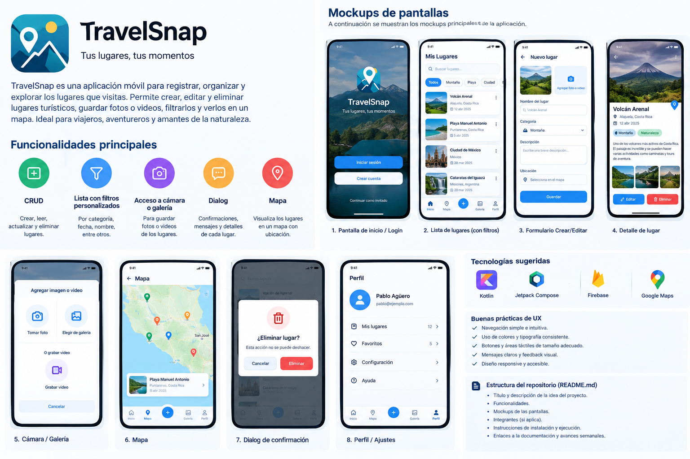

# TravelSnap

Aplicación para registrar lugares turísticos, consultar sus datos y organizar futuras visitas.

Proyecto individual de Pablo. Esta entrega corresponde al avance hasta la tarea 5.

## Avance de las tareas

| Tarea | Implementación |
| --- | --- |
| Idea del proyecto | Gestión de lugares turísticos, con fotografías, filtros y mapa previstos para futuras entregas. |
| Tarea 2 | Modelo Place, enumeraciones de categoría y provincia, IPlaceRepository, MemoryDataRepository, PlaceViewModel y Util. Recursos en español e inglés. |
| Tarea 4 | Activities y diseños XML para bienvenida, lista, formulario, detalle, mapa, fotografías y perfil. |
| Tarea 5 | Crear, consultar por identificador, actualizar y eliminar lugares. Confirmación antes de actualizar o eliminar. |

## Uso

1. Entrar con Continuar como invitado.
2. Abrir Gestión de lugares, llenar el identificador y los datos, y pulsar Guardar en la barra superior.
3. Para editar, escribir un identificador existente y pulsar Buscar por identificador. También se puede abrir un lugar de la lista, entrar al detalle y pulsar Editar.
4. Al encontrar un lugar se bloquea el identificador. Guardar pide confirmación para actualizar y Eliminar pide confirmación para borrar.
5. Limpiar vacía los campos y permite crear otro lugar.

La lista se actualiza al regresar del formulario. Los identificadores no se repiten. La latitud debe estar entre -90 y 90 y la longitud entre -180 y 180.

## Estructura

```text
app/src/main/java/com/industriaop/travelsnap/
    domain/model/          Place, PlaceCategory, Province
    domain/repository/     IPlaceRepository
    data/memory/           MemoryDataRepository
    viewmodel/             PlaceViewModel
    util/                  Util
    Activities y adaptador de la lista
```

El código sigue la estructura de TaskManager de la semana 7: Activities con XML y findViewById, navegación con Intent, Spinner, RecyclerView, AlertDialog y un ViewModel con métodos en companion object. El repositorio usa una lista mutable en memoria.

No se usa Flow, corrutinas, ViewBinding, fábricas de ViewModel, Compose, Room ni Glide. Los datos se pierden al cerrar el proceso de la aplicación. El idioma depende del idioma del dispositivo: español por defecto e inglés mediante values-en.

## Pantallas pendientes de funcionalidad

Mapa, fotografías y perfil tienen su pantalla y navegación. La integración del mapa, cámara, galería, filtros y cuentas de usuario queda pendiente para las tareas que soliciten esas funciones. Los controles correspondientes no realizan operaciones todavía.

## Mockups iniciales



Los mockups muestran la idea completa del proyecto. Las tecnologías sugeridas dentro de esa imagen no corresponden a esta implementación: este avance usa Kotlin y layouts XML. El diseño actual utiliza los controles básicos trabajados en clase.

## Ejecutar

Abrir la carpeta del repositorio en Android Studio, sincronizar Gradle y ejecutar app en un dispositivo o emulador con Android 13 o superior. Se conserva la configuración de SDK 37 y Gradle del proyecto.

Para compilar y ejecutar las pruebas unitarias en Windows:

```text
gradlew.bat assembleDebug testDebugUnitTest
```

## Entrega

Los cambios se entregan mediante una rama y un PR hacia main. La integración a main queda pendiente de la revisión del profesor ebarahonautn.
